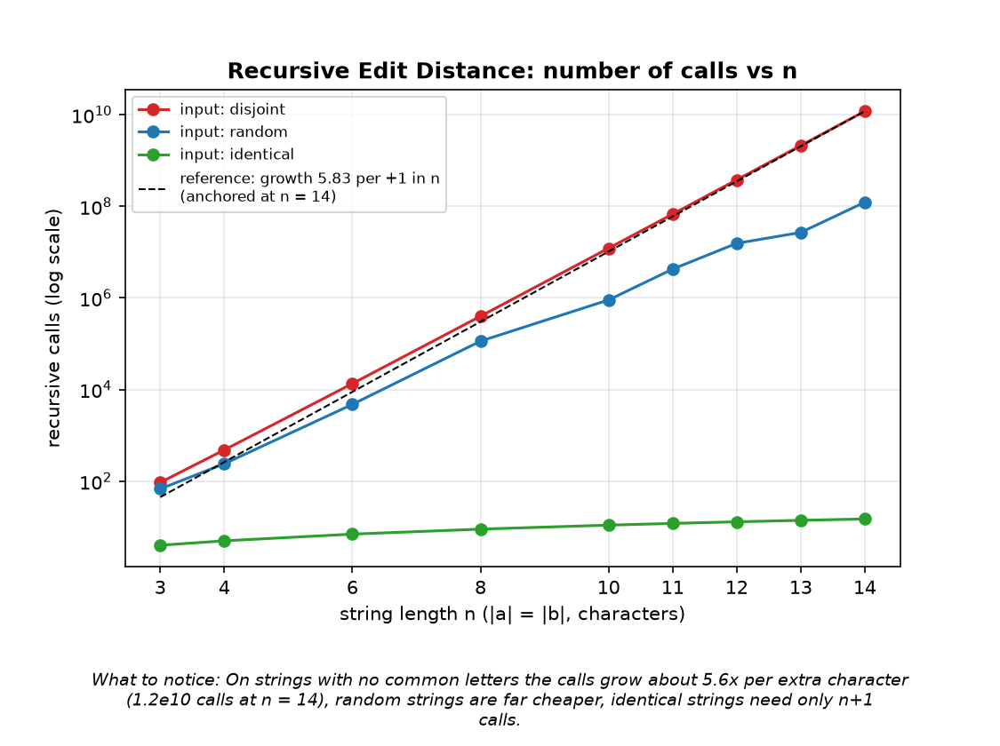
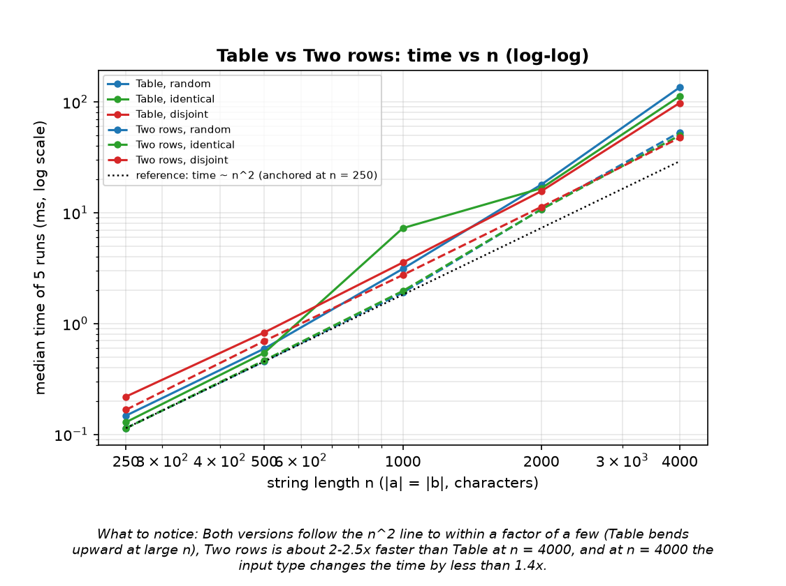
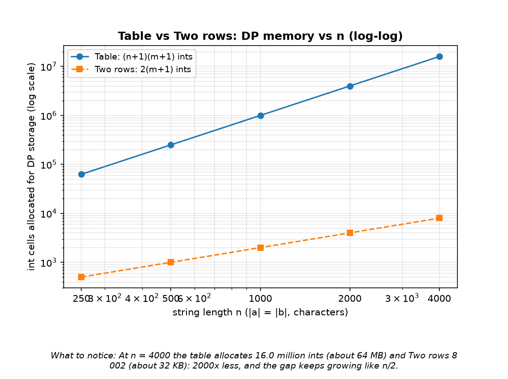
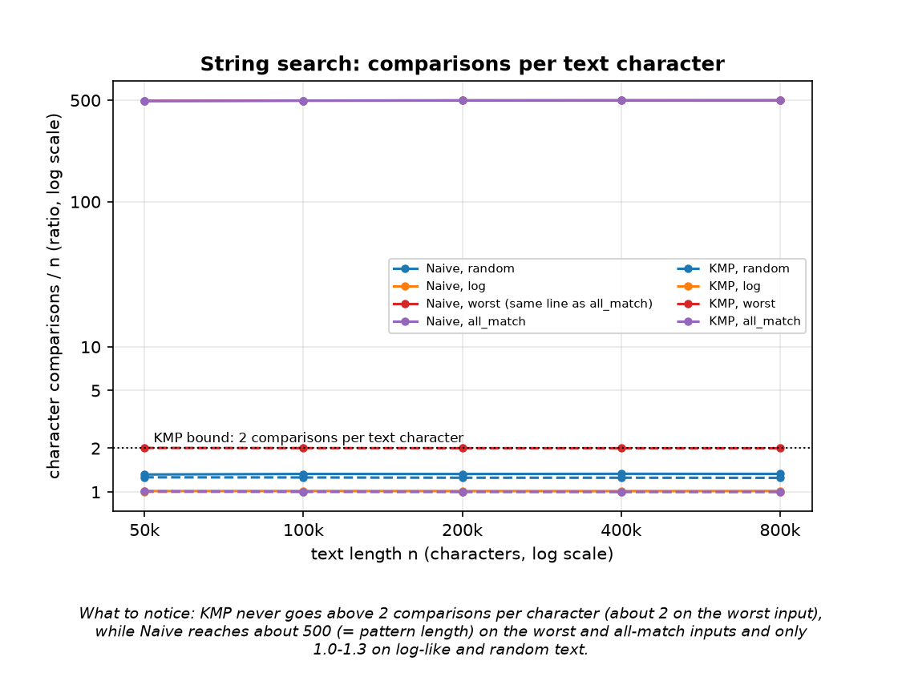
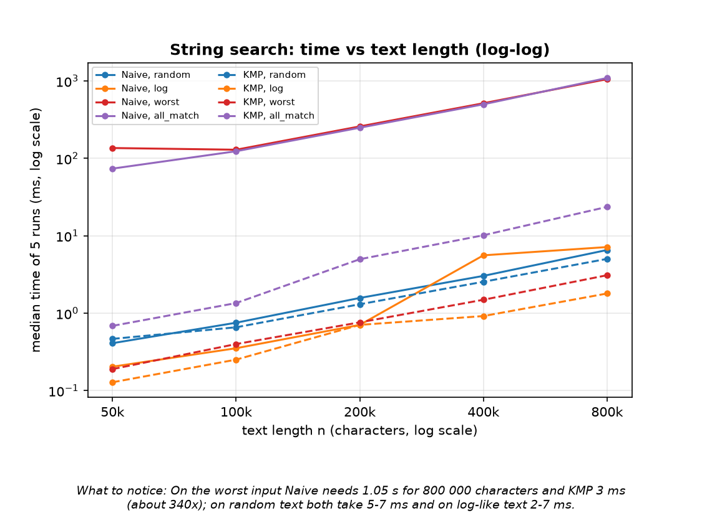
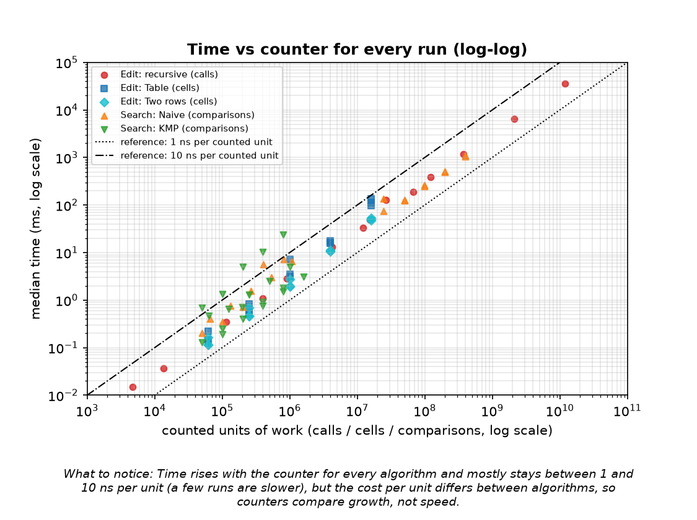

# Assignment 4 - Dynamic Programming and String Algorithms: Report

Student:MAKHAN SABINA, GROUP: SE-2509 | Code: `src/main/java/daa` | Data: `results/results.csv` | Plots: `results/plots/`

## 1. Experiment Design Card

> Written **before the first run** of the experiment. Changes made after the first run are listed in section 4 ("Changes after the first run").

| Card field | Content |
|---|---|
| **Question** | **Edit Distance:** Does the plain recursion really explode exponentially while Table and Two-rows grow like n·m, and does the *content* of the strings (random / identical / no common letters) change the cost of each version? **String search:** Does Naive reach about n·m comparisons on a bad input while KMP stays linear (≤ 2n), and how big is the gap on "friendly" inputs (random text, log-like text)? |
| **Sizes (n)** | **Recursive:** n = \|a\| = \|b\| ∈ {4, 6, 8, 10, 11, 12} (extended after the first run, see section 4). On the worst input the number of calls grows about 5.8× for every +1 in n, so n = 12 should already need ~10⁹ calls (seconds); larger n is not realistic. **Table / Two rows:** n = \|a\| = \|b\| ∈ {250, 500, 1000, 2000, 4000}. Doubling n should give 4× the cells; 4000×4000 = 16 M cells (64 MB for the full table) still runs in well under a second, 250 is big enough that the clock is not 0 ms. Largest/smallest = 16×. **Search:** text length n ∈ {50 000, 100 000, 200 000, 400 000, 800 000} (16×), pattern length m = 500 (the log pattern has 25 characters). Worst case for Naive then needs about n·m = 4·10⁸ comparisons at the top size, which is still < 1 s. |
| **Inputs** | **Edit Distance:** `random` – two independent random strings over {A,C,G,T}: the "average" case. `identical` – a = b: the best case for the recursion (it only walks the diagonal) – shows what matches do. `disjoint` – a = "aaa…", b = "bbb…": no character matches, the recursion has to try all three branches in every call = **worst case** for the recursion. For the DP versions it shows whether the data matters at all. **Search:** `random` – random DNA text and random pattern of length 500: the average case. `log` – synthetic log file (lines with date, level, service, code) and the pattern `ERROR svc=search code=503`: the realistic operator scenario. `worst` – text `AAAA…A`, pattern `AAA…AB`: Naive compares almost the whole pattern at every start and fails at the last character = **worst case for Naive**; KMP's worst case too. `all_match` – text `AAAA…A`, pattern `AAA…A`: every position matches (overlapping matches), tests output-heavy behaviour. |
| **Metrics** | `ops` (counted inside the algorithm): recursion = number of calls; Table and Two-rows = number of cell updates (each cell of the n×m table, base row/column not counted); Naive = number of character comparisons; KMP = number of character comparisons in the search **plus** in the LPS build. Reason: this is the unit of work the theory counts, independent of the laptop. `mem`: number of `int` cells allocated for DP storage (Table: (n+1)(m+1), Two rows: 2(m+1)) or for the LPS array (KMP: m); 0 for Recursive and Naive. Reason: the Table vs Two-rows trade-off is about memory. `time_ms`: median of 5 runs (3 runs for the recursive version, because it is slow), after a JIT warm-up. Reason: the clock shows constant factors that counters cannot see (cache, JIT), but it is noisy, so it is never used alone. `result` (distance / number of matches) is stored to check that the runs are correct. |
| **Prediction** | **Recursive:** `disjoint`: ops(n+1)/ops(n) ≈ 5.8 (≈ (3+2√2)ⁿ), i.e. a straight line on a log-y plot; n = 12 is around 10⁹ calls. `identical`: exactly n+1 calls (linear, almost invisible next to the others). `random` (4 letters): exponential as well, but far below `disjoint`. **Table / Two-rows:** `ops` = n² exactly for every input type; time grows ≈ 4× per doubling of n and does **not** depend on the input type; both versions have the same `ops`, Two-rows is the same speed or slightly faster; `mem` = (n+1)² vs 2(n+1), i.e. the ratio grows about n/2 (≈ 2000× at n = 4000). **Naive:** `worst` ≈ (n−m+1)·m ≈ 500·n comparisons, `all_match` about the same; `random` ≈ 1.33·n (a first-character mismatch most of the time); `log` ≈ 1.0–1.2·n. **KMP:** ≤ 2·(n+m) always; about 2·n on `worst` (each text character is compared twice), about n on `all_match`, ≈ 1.3·n on `random`. Time: on `worst` KMP should be tens of times faster than Naive, on `random`/`log` the two should be close (KMP maybe even slower because of the LPS array and the extra branching). |
| **Plots** | 1. Recursive calls vs n (log y, 3 inputs + reference line 5.8ⁿ): *does the recursion grow exponentially and how much do matching characters help?* 2. DP time vs n (log-log, Table vs Two-rows, 3 inputs + n² reference): *does the time follow n·m and ignore the input?* 3. DP memory cells vs n (log-log): *what does Two-rows save?* 4. Search comparisons per text character (ops/n, log y) vs n for all inputs, Naive vs KMP (a ratio): *which input is the worst for each algorithm, and does KMP stay below 2?* 5. Search time vs n (log-log), Naive vs KMP: *does the clock agree with the counters?* 6. Time vs ops for every run (log-log scatter): *is the counter a good predictor of the clock?* |

## 2. Plots and results

**Plot 1.** On strings with no common letters the number of calls grows about 5.6x per extra character (1.2e10 calls at n = 14); identical strings need only n+1 calls and random strings are far cheaper.

**Plot 2.** Both DP versions roughly follow the n^2 line (Table bends upward at large n), Two rows is 2.1-2.5x faster than Table at n = 4000, and at n = 4000 the input type changes the time by less than 1.4x.

**Plot 3.** At n = 4000 the table allocates 16.0 million ints (about 64 MB) and Two rows 8 002 (about 32 KB): 2000x less, and the gap keeps growing like n/2.

**Plot 4 (ratio).** KMP never goes above 2 comparisons per text character (2.001 on the worst input), Naive reaches 499.7 (about the pattern length, 500) on the worst and all-match inputs and only 1.0-1.3 on log-like and random text.

**Plot 5.** On the worst input Naive needs 1.05 s for 800 000 characters and KMP 3.1 ms (about 340x); on random text both take 5-7 ms.

**Plot 6.** Time rises with the counter for every algorithm and mostly stays between 1 and 10 ns per unit (a few runs are slower), but the cost per unit differs between algorithms, so counters compare growth, not speed.

## 3. Prediction vs result

**Recursive Edit Distance.**
*Expected:* x5.8 calls per +1 in n on `disjoint`, about 10^9 calls at n = 12, exactly n+1 calls on `identical`, exponential but much smaller growth on `random`.
*Saw:* `disjoint`: the ratio per +1 was 5.3 (n = 4..6), 5.5 (n = 8..10), 5.6 (n = 13, 14), so it climbs slowly towards 5.83 but never reached it; at n = 12 there were 3.8e8 calls, about 3x fewer than I guessed (my constant in front of the exponential was too big). I believe the slow climb is the usual polynomial factor in front of the exponential, but I did not check this. `identical`: exactly n+1 calls (13 at n = 12), as predicted. `random`: 1.2e8 calls at n = 14, about 100x below `disjoint`, but not smooth (n = 13 has only 1.7x more calls than n = 12), because the number of calls depends on which letters happen to match.

**Table and Two rows.**
*Expected:* `ops` = n^2 for every input, time x4 per doubling of n, independent of the input, Two rows the same speed or slightly faster, memory ratio about n/2.
*Saw:* `ops` = n^2 exactly (16 000 000 at n = 4000) and `mem` 16 008 001 vs 8 002 (ratio 2000), as predicted. Three predictions were too optimistic: (1) 16x larger n (250 -> 4000) cost 285-916x more time instead of 256x, worst for Table; I suspect cache/memory effects of the 64 MB table, but I did not measure them. (2) The input type did matter for the clock although not for the counter: at n = 4000 Table needed 135 ms on `random`, 112 ms on `identical`, 98 ms on `disjoint`; Two rows 53, 50, 48 ms. A likely reason is that the equal/not-equal branch is unpredictable on random letters, but I did not test this. (3) Two rows was not "slightly" faster but 2.1-2.5x faster at n = 4000, again probably because there is no big table to allocate and walk through memory.

**Naive and KMP.**
*Expected:* Naive about (n-m+1)*m comparisons on `worst` and `all_match`, about 1.33n on `random`, 1.0-1.2n on `log`; KMP at most 2n, about 2n on `worst`, about n on `all_match`; KMP tens of times faster on `worst`, similar on random text.
*Saw:* the counters match: Naive `worst` 399 750 500 = (800 000 - 500 + 1) * 500 exactly, `random` 1.332n, `log` 1.016n; KMP `worst` 2.001n, `all_match` 1.001n, `random` 1.25n (a bit below my 1.3n). The time gap on `worst` was larger than predicted: 340x (the comparison counts differ by 250x, and KMP also needs less time per comparison). On `random` the times were close (6.6 vs 5.0 ms). Two things I cannot fully explain: on `log` KMP was 4x faster (1.8 vs 7.2 ms) although both do about one comparison per character, and Naive on `log` has an outlier (5.6 ms at n = 400 000 against 0.7 ms at 200 000); I suspect garbage collection or JIT effects, but I did not investigate. KMP on `all_match` was its slowest input in time (23.6 ms) although it needs only 1.0 comparison per character; a likely reason is that it has to build a list of 799 501 matches (boxed `Integer` objects), not the comparisons.

## 4. Changes after the first run

The first run is kept in `results/first_run_results.csv`. After seeing it I changed three things:

1. **`random` input for Edit Distance.** In the first run every n used a new random pair, and the number of recursive calls was not monotonic (951 999 calls at n = 10, 57 978 at n = 12), so the curve told more about the luck of the pair than about n. Now the strings of size n are prefixes of the strings of size n+1 (`Generator.editPair`). Only the `random` Edit Distance rows changed; all other counters are identical in both runs.
2. **Warm-up.** In the first run the times for `log` made no sense: Naive needed 6.8 ms for 50 724 comparisons (about 135 ns each) and 54.9 ms for 812 614 comparisons (about 68 ns each), while on `random` text the same loop needs about 4 ns per comparison. The warm-up had only used inputs without matches, so the JIT had never seen the "match found" branch; that is my guess, the change below removed the problem. Now the warm-up uses every input type and every configuration gets one untimed run first (not for the recursive version).
3. **Sizes for the recursion.** I added n = 13 and n = 14 (one run each, because they take 6.6 s and 36 s) to measure the limit instead of extrapolating it. After that I noticed that 14 / 4 = 3.5 breaks the rule "largest at least 4x the smallest", so I also added n = 3 (14 / 3 = 4.7). The three n = 3 rows were measured afterwards with the same code and the same procedure (median of 3 runs, warm-up of the recursive method) and inserted into `results.csv`; `Experiment.REC_SIZES` now contains 3, so `mvn compile exec:java` produces the same set of rows.

## 5. Short answers

**Which input made your string search slowest, and why does it do that?**
Naive on `worst` (text `AAAA...A`, pattern `AAA...AB`) and on `all_match`: about 4.0e8 comparisons, 1.05 s and 1.09 s for 800 000 characters, i.e. about 500 comparisons per text character. At every start position Naive matches almost the whole pattern (it fails only at the last character, or matches completely), then forgets everything and starts again one position later, so it reads the same text characters up to m times. KMP on the same text needs 1.6 million comparisons (3.1 ms) because after a failure it reuses the LPS border instead of going back. In time (not in comparisons) KMP's slowest input was `all_match` (23.6 ms), which I think comes from storing 799 501 matches.

**How large an n could the recursive Edit Distance handle, and what stopped it?**
On the worst input (no common letters) n = 14 was the largest I ran: 1.19e10 calls and 36 s in one run. Every +1 multiplies the calls by about 5.6, so n = 15 would take about 3.5 minutes, n = 16 about 20 minutes and n = 18 about 10 hours (extrapolated, not measured). What stops it is CPU time only: the recursion depth is at most 28 at n = 14 and no DP storage is used, so memory and stack are not the problem. On `identical` strings the same code needs only n+1 calls, so the limit depends strongly on the input.

**What do you gain and what do you lose when you use two rows instead of the full table?**
I gain memory: 2(m+1) ints instead of (n+1)(m+1), i.e. 8 002 instead of 16 008 001 at n = 4000 (2000x less), and in this experiment also speed (2.1-2.5x faster at n = 4000). The number of cell updates is the same (n*m = 16 million). I lose the table itself: the distance is correct, but I cannot walk back through the table to reconstruct which insertions, deletions and replacements were used, and older rows cannot be reused for another question.

**If you had to choose one string search for your city platform, which one and why?**
KMP. In my measurements both methods are equally good on random and log-like text (about one comparison per character), but KMP guarantees at most 2n comparisons for any input, while Naive can reach n*m (1.05 s instead of 3 ms for 800 000 characters), and I do not control what is inside the operators' log files. The price is an LPS array of m ints and a few more lines of code. For the search box with short street names (tens of characters) Naive would also be fast enough, so this choice matters mostly for the log files. The synthetic log I used is only a guess about real logs.

## 6. A paragraph on time

The measured times range from under 0.01 ms (small recursive cases) to 36 s (recursive, n = 14) and were taken on a single-core container with JDK 21, as the median of 5 runs (3 for the recursive version, 1 for n >= 13), so another computer will give other numbers. They are not my only evidence because the clock also contains JIT compilation, garbage collection, cache effects and other processes: the table has an outlier (7.3 ms for `identical`, n = 1000, where about 3 ms would fit the rest), and Naive on `log` has another one (see section 3). The counters do not have this problem: they are identical on every run and give the exact quantities the theory talks about (n^2 cells, (n-m+1)*m comparisons, at most 2n comparisons for KMP, about 5.6^n calls). The clock was useful where the counters cannot see anything, namely the 2x gap between Table and Two rows with the same number of cell updates, and plot 6 shows that time and counter move together (mostly 1-10 ns per unit).
